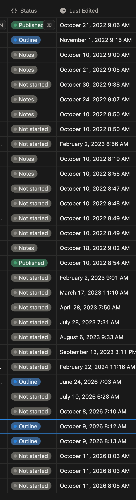

`console.log('Hello World!')`

The start. The beginning. However, it’s not the beginning for me, as I’ve been on this developer or software engineering journey for a number of years now.

But it is the beginning of trying something new—building in public. Working on things and talking about them for all to see.

This is something that is so uncomfortable for me. I sometimes get stuck scrolling the sub-comments, which can be filled with a lot of vitriol. So, I’m scared people will look at my sideways and think I’m stupid. But I also see a lot of encouragement for doing work in this way. There are a lot of kind and helpful people out there as well. So, I’m hopeful. I hope that there are people out there who will see what I’m doing and offer constructive insight and criticism rather than negative criticism.

